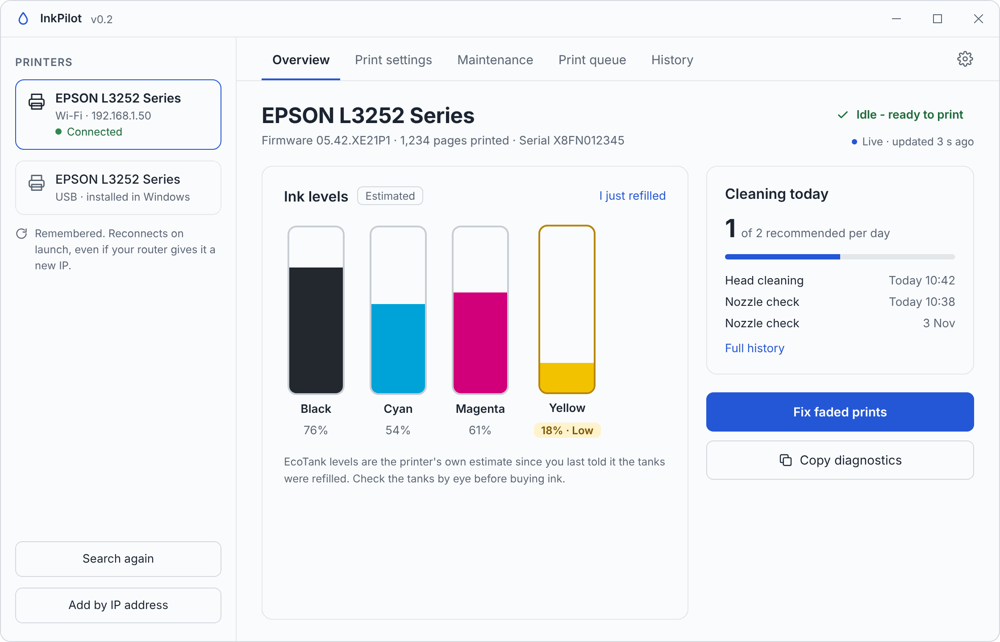
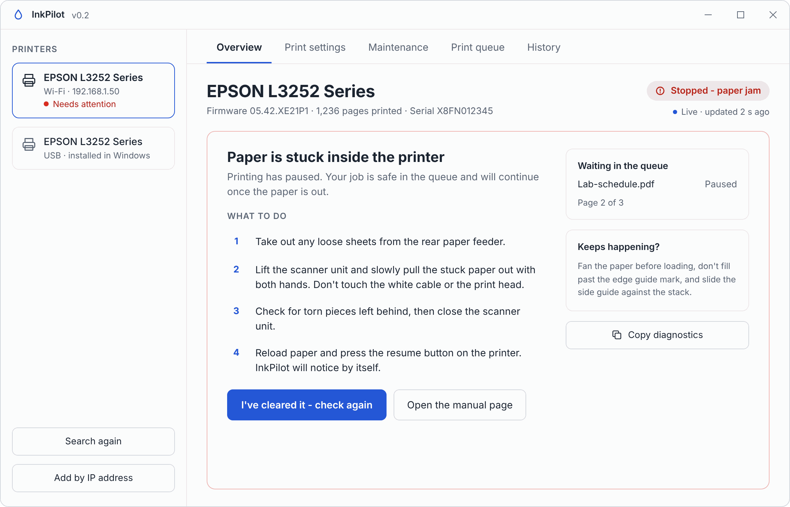
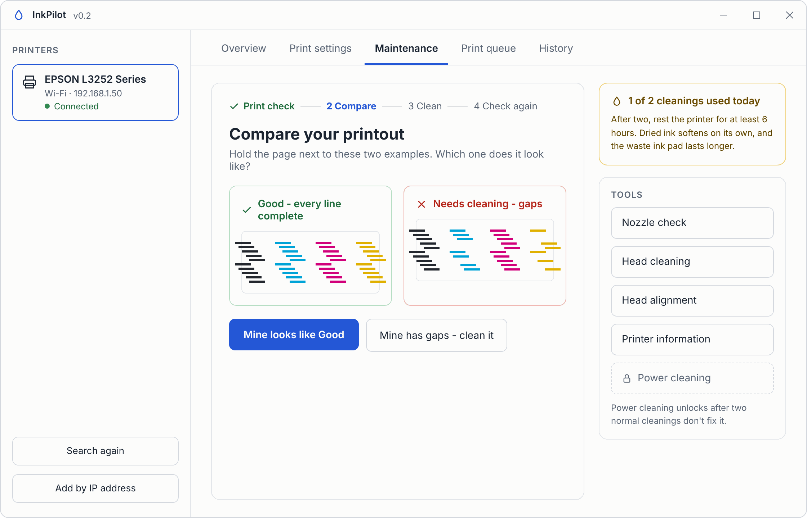
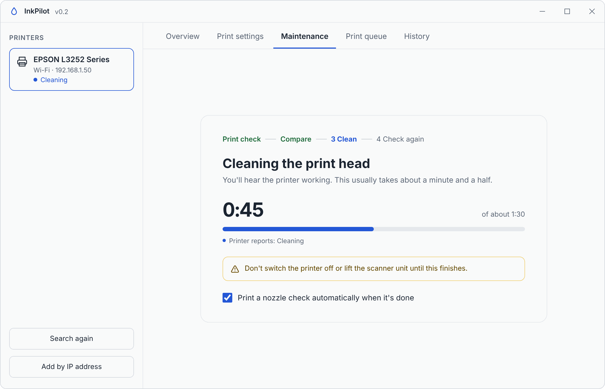
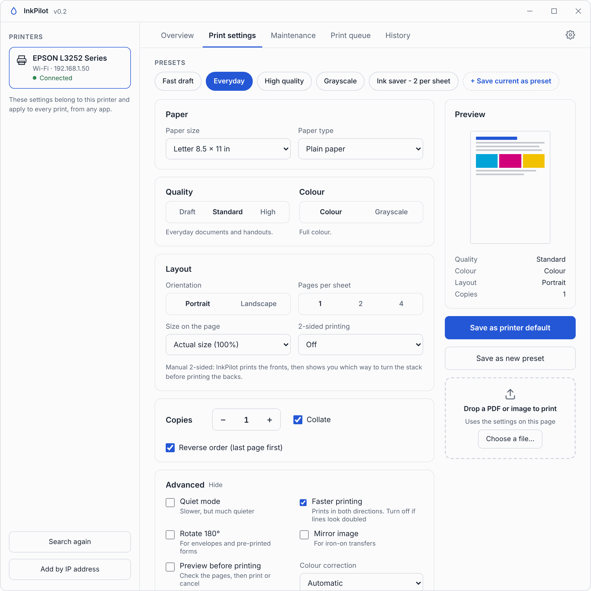
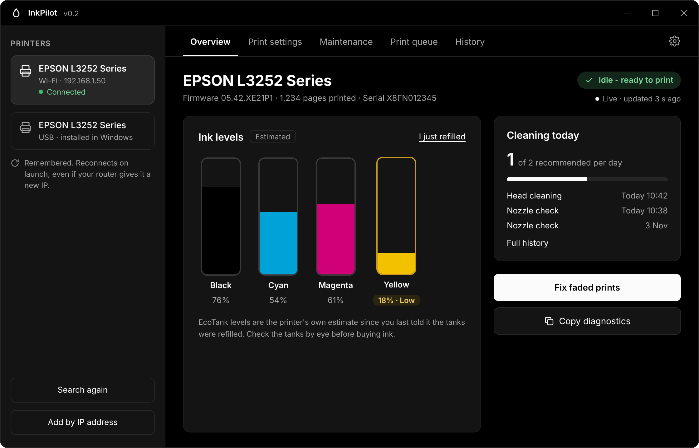
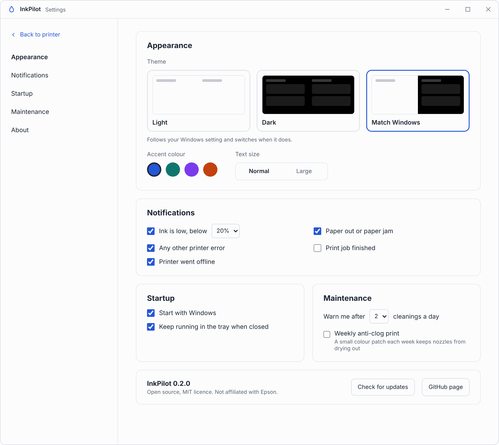
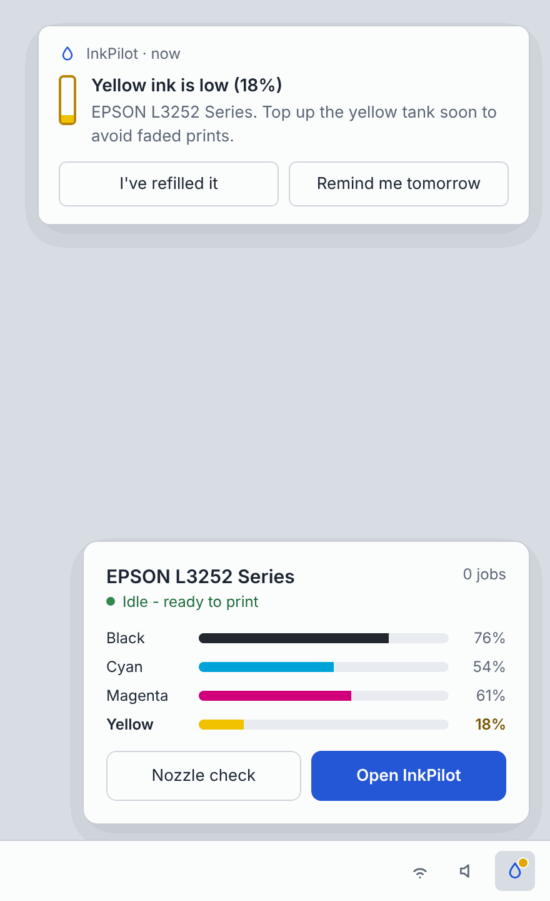
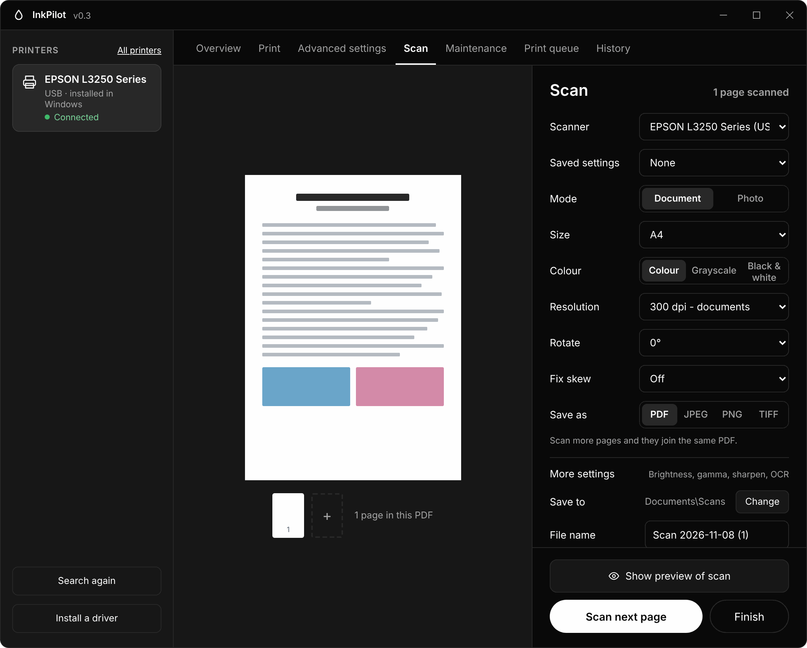

  

<h1 align="center">InkPilot</h1>

<b>An open-source printer manager for Epson printers.</b>

Setup, ink levels, maintenance, print settings and print jobs, all in one simple app. No bloat, no ads, no account sign-ups.

  

> ⚠️ **Status: early development.** The screenshots below come from the v0.2 UI design. There's no public release yet. Star or watch the repo to follow progress.

---

## Why InkPilot?

Epson's own software works, but it's spread across several separate tools, it's heavy, it nags you, and it looks different for every model. InkPilot aims to be one clean, fast utility that works the same way across Epson printers.

## Features

### Live status and ink levels
See at a glance whether the printer is ready, busy or stuck, with live ink levels for every colour. Low ink is flagged before it ruins a print. For EcoTank models, tap **I just refilled** after topping up the tanks.

### Clear help when something goes wrong
When the printer stops, InkPilot tells you what happened in plain words and walks you through the fix step by step. Your print job waits safely in the queue until you're done.

  

### Guided maintenance
No more guessing from a nozzle check printout. InkPilot shows a good and a bad example side by side, then cleans only if it's needed. It tracks how many cleanings you've done today, so you don't waste ink or wear out the waste ink pad.

  
  

### Print settings and presets
Everything from Epson's driver tabs in one page: paper, quality, colour, layout, two-sided printing and more. Save your own presets like *Everyday*, *Fast draft* or *Ink saver*, and they apply to prints from every app.

  

### Light and dark mode
Follows your Windows theme by default, or pick Light or Dark yourself.

  

### App settings
Choose a theme and accent colour, decide which alerts you want, start with Windows, and set maintenance reminders.

  

### Coming later

| Tray icon and notifications | Scanning |
|---|---|
|  |  |
| Lives in the Windows tray. Ink at a glance, plus a notification when ink runs low, paper runs out, a job finishes or an error appears. | Scan documents and photos on all-in-one models, save as PDF, JPEG, PNG or TIFF. *(Proposal)* |

See the full plan in [docs/ROADMAP.md](docs/ROADMAP.md).

## Supported printers

The first test printer is the **Epson EcoTank L3252**. The goal is to support as many Epson models as possible over time.

See [docs/SUPPORTED_PRINTERS.md](docs/SUPPORTED_PRINTERS.md) for the current list. If you own an Epson printer and want to help test, please [open a printer support request](https://github.com/CreativeBuilds1236/InkPilot/issues/new?template=printer_support.md).

## Platforms

- Windows (first target)
- Linux (planned)

## Contributing

Contributions are welcome, especially testing on printer models we don't have. Please read [CONTRIBUTING.md](CONTRIBUTING.md) before opening a pull request.

## License

InkPilot is open source under the [MIT License](LICENSE).

## Disclaimer

InkPilot is an independent project. It is **not affiliated with, endorsed by, or supported by Seiko Epson Corporation**. "Epson" and "EcoTank" are trademarks of Seiko Epson Corporation, used here only to describe which printers the software works with.

Maintenance features send commands directly to your printer. Use them at your own risk. Features that could damage a printer or void its warranty will always be clearly marked and will ask for confirmation first.

---

Made by [Rajesh Divakaran](https://github.com/CreativeBuilds1236)
